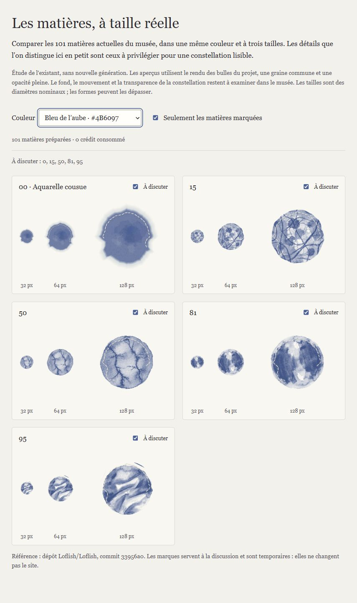

# Matières du musée : diagnostic et prochains essais

9 octobre 2026. Étape 3 du processus : état initial ; préparation de l'étape 4 consacrée aux visuels. Le code du site n'a pas été modifié pour cette étude.

## Résultat livré

Le fichier autonome `Comparateur_des_matieres.html` réunit les 100 matières issues d'images et l'aquarelle cousue procédurale 00. Il reprend le moteur de dessin du commit `33956a0b7f6a065b5179373d2f4f16d90a44ffdb`, avec une graine commune, la palette existante et trois diamètres nominaux : 32, 64 et 128 pixels CSS.

Il permet de changer de couleur et de marquer les matières à discuter. Les marques sont temporaires. La sélection 00, 15, 50, 81, 95 visible dans la capture est un échantillon choisi par l'assistant pour la discussion ; ce n'est pas une sélection approuvée par le créateur.

## Contrôles effectués

- Les 303 images d'aperçu sont chargées dans le navigateur.
- Le changement de couleur bleu → corail et le filtre de sélection ont été exercés ; une sélection unique n'affiche qu'une fiche, une sélection de cinq matières en affiche cinq.
- L'affichage a été observé dans le navigateur au format ordinateur et avec une fenêtre de 390 × 844. Une disposition sur deux rangées évite que le grand aperçu déborde sur les cartes étroites.
- Le statut indique désormais « matières préparées » pour rester exact lorsque le catalogue est filtré.
- Le relevé de console du comparateur n'a retourné aucune erreur ni avertissement au moment du contrôle.

Cette vérification porte sur l'outil de comparaison. Elle ne constitue ni un contrôle visuel détaillé de chaque matière dans chaque couleur, ni l'audit du musée. Le fond, l'opacité et le mouvement réels de la constellation ne sont pas reproduits ici. Les dimensions nominales ne garantissent pas un contour exactement circulaire de cette dimension.

## Lecture artistique de l'échantillon

Ces observations sont des jugements de conception, à confronter au goût du créateur.

| Matière | Observation dans le comparateur | Conséquence pour les essais |
|---|---|---|
| 00 — aquarelle cousue | Contour diffus et masse de pigment reconnaissables ; couture très discrète à 32 px | Conserver comme référence de douceur ; vérifier la visibilité du fil sans durcir le bord |
| 15 — fibres | Enchevêtrement riche à grande taille ; les fils se fondent en une texture plus compacte en petit | Évaluer l'espacement des fibres avant de chercher une résolution supérieure |
| 50 — fissures | Réseau de grandes fissures encore perceptible en petit | Bonne référence de structure large ; éviter d'accumuler des microfissures |
| 81 — touches peintes | Alternance de grandes zones claires et foncées lisible à 32 px | Référence utile pour une matière picturale identifiable dans la constellation |
| 95 — plis | Plis diagonaux larges reconnaissables à petite taille | Référence utile pour le relief textile ; vérifier son intensité par rapport aux bulles plus douces |

## Recommandation : tester le rendu avant de produire davantage

Le catalogue contient déjà une diversité visible dans l'échantillon. Le nombre de nouvelles images n'est donc pas, à lui seul, un objectif pertinent. Commencer par des essais locaux réversibles utilisant les images existantes, puis réserver Higgsfield aux manques qui subsistent.

### Essai A — lisibilité dans la constellation

Comparer les mêmes cinq matières, aux mêmes emplacements, tailles et couleurs, sur le fond réel. Garder une référence intacte et n'ajuster qu'un paramètre à la fois : opacité de la bulle ou intensité du fond. Ne pas modifier simultanément couleurs, mouvement et texture.

Critère de réussite : mieux distinguer les matières à petite taille tout en conservant le calme et la douceur du musée. Vérifier au moins une couleur foncée et une couleur claire. Coût de génération : 0 crédit. Cet essai reste à réaliser.

### Essai B — présence du fil et des fibres

Comparer un ajustement local du fil procédural de la 00 avec le rendu actuel. Pour les fibres de la 15, commencer par examiner l'image existante à la taille finale ; une nouvelle image ne se justifie que si la structure doit réellement changer.

Critère de réussite : une évocation textile perceptible sans transformer la couture en cercle décoratif net. Coût du premier essai local : 0 crédit. Aucun ajustement du site n'est encore effectué.

### Essai C — génération ciblée, seulement si nécessaire

Si l'essai B et le retour artistique montrent un manque, préparer une seule variation de matière fibreuse : quelques fibres dominantes espacées, zones de repos, contour organique et pigment irrégulier. Préserver la recoloration par la palette du projet. Comparer la variation et l'existant dans le même moteur avant de produire un lot.

Le prompt, l'image de référence éventuelle, le modèle, le format, le coût affiché et le nombre maximal de tentatives seront présentés ensemble avant dépense. La capacité à obtenir une transparence utilisable et le besoin de préparation du fichier devront être vérifiés sur le résultat ; ils ne sont pas garantis par un prompt.

## Crédits et décisions

- Le créateur a précisé que le quota renouvelé concernait ChatGPT/Codex, et non Higgsfield.
- Aucun crédit Higgsfield consommé par cette étude. Aucun achat, génération ou publication soumis.
- Le précédent relevé du compte affichait 574 crédits ; il n'a pas été actualisé le 9 octobre. L'échéance et le plafond d'essai restent à confirmer avant dépense.
- La sécurité Windows a été réactivée par le créateur. Le comparateur est accessible après cette réactivation.
- Retour attendu : matières qui incarnent le mieux le musée et raisons de cette préférence. Ce retour guide les ajustements ; il ne nécessite pas d'examiner les 101 fiches.

## Retour du créateur et essai livré — 9 octobre

Le créateur préfère explicitement **00, 81 et 95**. Les autres matières lui plaisent moins, sans demande de suppression. Ces trois références deviennent prioritaires pour les comparaisons.

Un premier essai statique autonome est livré dans `Essai_lisibilite_00_81_95.html` : trois matières, trois couleurs (bleu, pétale, jaune), trois tailles nominales (34, 38, 64 px), et trois intensités de fond (70 %, 55 %, 40 %). Les bulles restent identiques quand on change l'intensité du fond.

L'intensité de référence 70 % et les diamètres de base 34/38 px viennent du code actuel. L'essai utilise l'image de fond du projet mais ne reproduit pas l'ensemble de la constellation : animation, atmosphère, fibres du fond et zones d'atténuation sont absentes. Il constitue la première partie de l'essai A, pas sa validation dans le musée complet.

Vérification : les 27 aperçus se chargent ; les trois boutons actualisent l'état sélectionné ; le contrôle mobile de 390 × 844 montre une largeur de contenu égale à celle de la page, sans débordement horizontal ; le relevé de console ne retourne aucune erreur ni avertissement. La disposition mobile a été observée. La référence 70 % est rétablie à la livraison.

Jugement provisoire : le changement de fond est subtil. Aucun gain suffisamment établi ne justifie à ce stade de modifier le réglage du site. La préférence du créateur et une confirmation dans la constellation complète restent nécessaires. L'essai C sur les fibres passe au second plan au vu des références choisies.

## Fin de cette étape et suite

### Orientation actualisée : fond plus intense et plus animé

Le 9 octobre, le créateur demande de comparer 80–85 % et davantage de mouvement, à la fois dans les pigments et dans la dérive du fond. Cette demande remplace la piste prioritaire d'un fond atténué ; aucune préférence définitive entre 80 et 85 % n'est encore actée.

Le même fichier `Essai_lisibilite_00_81_95.html` propose désormais 70 %, 80 % et 85 %. Il embarque la vidéo de fond existante, sans génération supplémentaire. Deux mouvements sont comparables : vidéo normale + dérive de 140 secondes par trajet ; vidéo à 1,15× + dérive de 90 secondes. L'amplitude reste identique. Le bouton Pause arrête vidéo et dérive. Une préférence système de réduction du mouvement déclenche une pause initiale ; cette branche est prévue dans le code mais n'a pas été simulée dans le navigateur.

Contrôles de cette version : 27 images chargées ; vidéo décodée et en lecture à 1,15× ; sélection à 85 % appliquée ; Pause confirmée sur vidéo et dérive ; affichage mobile observé sans débordement horizontal ; aucune erreur ni avertissement retourné par le relevé de console. Les tests n'établissent pas la fluidité sur des téléphones physiques ni la qualité de chaque raccord de boucle.

Recommandation provisoire : partir de 80 % et comparer 85 % en gardant le mouvement constant, puis comparer les mouvements à intensité constante. Accentuer une peinture existante peut servir la direction artistique appréciée ; surveiller la lisibilité du rose et du jaune, la place visuelle des bulles et le confort pendant la lecture. La planche ne reproduit toujours pas le masque du logo, l'atmosphère et les mouvements des bulles. Tout réglage choisi devra être confirmé dans la constellation complète.

Le code du site reste intact et aucun crédit Higgsfield n'a été consommé.

### Correction du prototype après retour d'affichage

Le créateur a signalé un fond invisible. Le problème a été reproduit à l'écran malgré une vidéo chargée et en lecture. Le calque de peinture utilisait un indice d'empilement négatif ; il a été placé explicitement au niveau 0, et les matières au niveau 1. Après reconstruction et rechargement, le fond est à nouveau visible derrière les bulles. Cette correction porte uniquement sur la planche d'essai, sans changement du musée.

Livré : comparateur fonctionnel, capture de l'échantillon, diagnostic limité et premier essai statique sur le fond du musée. À poursuivre : retour sur cet essai, comparaison dans la constellation complète puis validation artistique. L'audit intégral frontend/backend, les corrections et la préparation de la démonstration familiale restent les étapes suivantes de la feuille de route.
