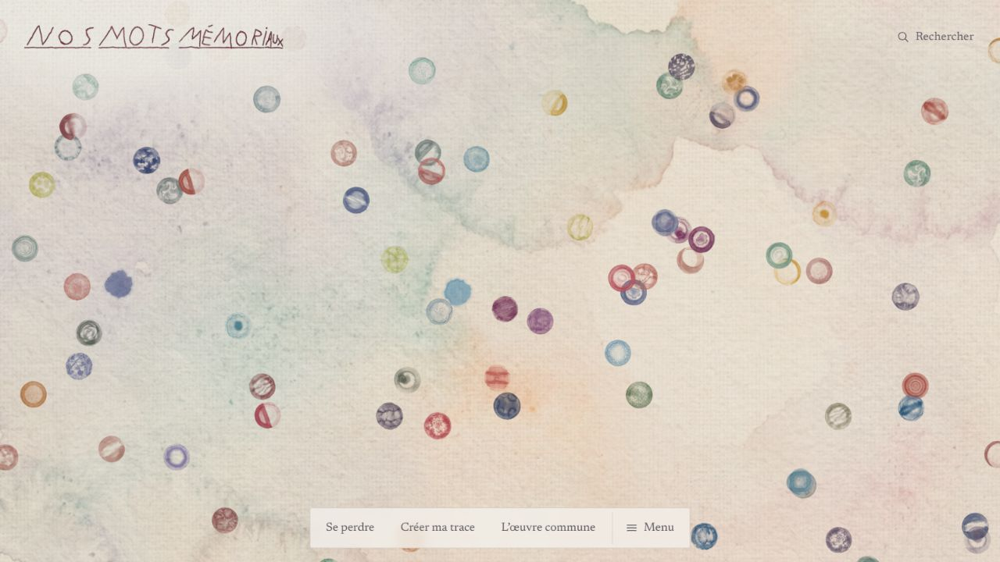
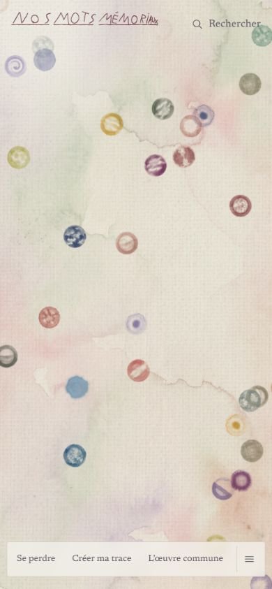

# Premier état initial — Nos Mots Mémoriaux

8 octobre 2026. Point d'étape ; aucun audit exhaustif ni changement artistique effectué.

## Référence

- Dépôt : https://github.com/Loflish/Loflish
- Branche récupérée : `claude/practical-newton-r1t0oq`
- Commit : `33956a0b7f6a065b5179373d2f4f16d90a44ffdb`
- Prévisualisation locale : http://127.0.0.1:4317/
- Cette adresse fonctionne sur l'ordinateur de travail ; elle n'est pas un lien public à envoyer aux proches.

## Ce qui est effectivement vérifié

- Installation des dépendances frontend verrouillées, sans exécution des scripts d'installation.
- Compilation du prototype avec vérification TypeScript : réussie.
- Vue de la constellation : observée au format ordinateur et dans une fenêtre de 390 × 844.
- Parcours mobile « Se perdre → Ouvrir la trace » : ouverture d'un profil de démonstration observée.
- Relevé initial de console : aucune entrée error/warn retournée au moment du contrôle. La couverture est limitée aux pages et au moment observés.
- Dépôt sans changement de fichier suivi après compilation.

Les tests du backend, les autorisations, les contributions persistantes, le référencement, les mesures de performance et l'accessibilité complète restent à examiner.

## Ressources visuelles constatées dans la copie

Le code expose 100 matières issues de fichiers et la matière procédurale 0. Six matières utilisent un PNG sélectionné à la place du WebP portant le même numéro : ce ne sont pas six matières supplémentaires.

Le dossier public/hd contient 143 fichiers : 129 WebP, 6 PNG, 5 MP4 et 3 WebM. Plusieurs vidéos sont des encodages ou résolutions alternatifs d'une même animation. Ce compte ne décrit donc pas 143 créations originales et ne représente pas le volume téléchargé par une visite.

Les sprites de la constellation sont calculés depuis ces matières et recolorés selon la palette du projet. Une image plus grande ou plus détaillée ne garantit donc pas un meilleur résultat final : le passage par ce rendu et la taille d'affichage doivent être comparés.

## Première lecture artistique — propositions à éprouver

1. **Différenciation des matières.** Comparer chaque matière en petit, moyen et grand, dans les mêmes couleurs. Repérer les détails qui survivent dans la constellation et les familles qui se ressemblent trop. Cette évaluation doit précéder toute dépense pour ajouter des variantes.
2. **Rapport entre fond et bulles.** Essayer de faibles ajustements de lisibilité pour que les contours, les lavis et les teintes restent perceptibles. Le résultat doit conserver l'atmosphère douce appréciée par le créateur.
3. **Continuité du mouvement.** Observer l'approche d'une bulle, son aperçu et l'entrée dans le profil, puis comparer des affinements de rythme. Le calme de l'expérience et les choix de réduction du mouvement sont à préserver et à vérifier.

Ces pistes sont des jugements de conception tirés d'une première observation. Elles ne sont pas des défauts fonctionnels démontrés ni des décisions de remplacement.

## Higgsfield

Le compte connecté affiche **Plus Plan** et **574 crédits restants**. Aucune génération ni achat soumis. La date de renouvellement/expiration et les avantages exacts restent non confirmés. Les essais devront être présentés avec leur coût actuel et un plafond approuvé.

## Captures de référence

### Ordinateur

### Petit écran

## Prochain résultat attendu

Une comparaison visuelle permettant de choisir des améliorations précises, avec réutilisation de l'existant chaque fois qu'elle répond au besoin. Les générations Higgsfield pourront ensuite cibler les manques démontrés. Le premier jalon reste une démonstration destinée à la famille et aux amis.
